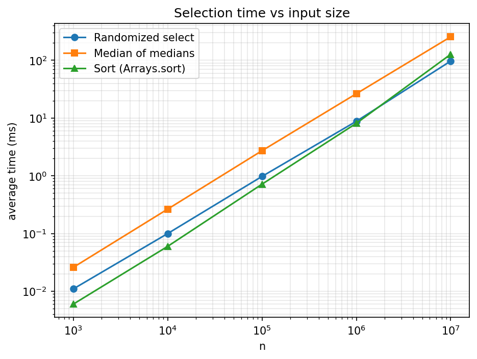
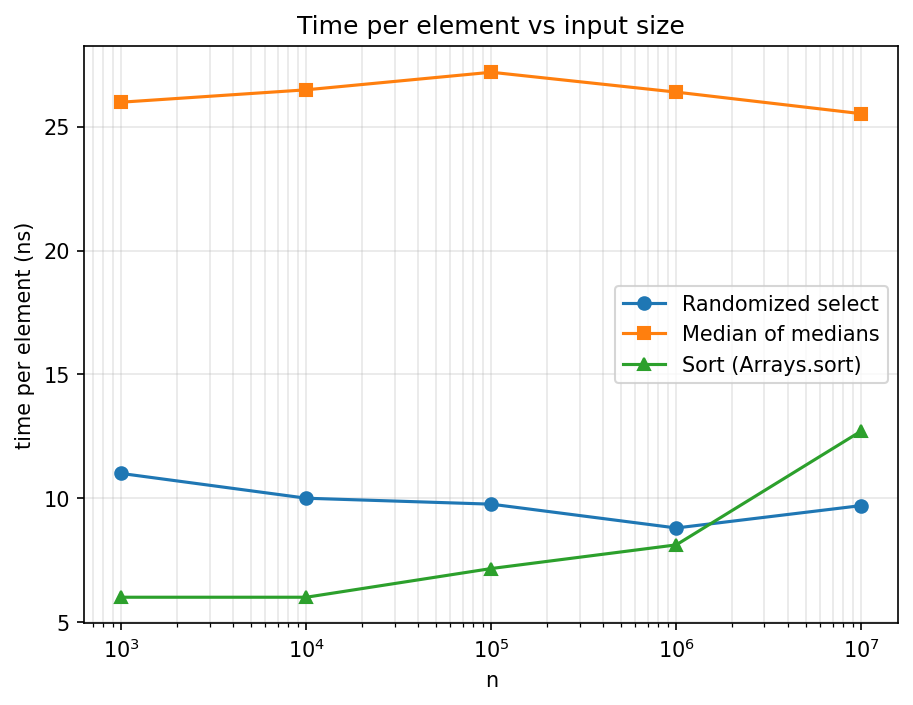

# CSE321 Assignment 1: Divide and Conquer
**Name:** Omar Assem  **ID:** 23010610

## Problem 1: Selection algorithms

### 1.1 Implementation
All three methods find the k-th smallest element (k is 1-based) and work in place.

- **Randomized select (CLRS 9.2).** Pick a uniformly random pivot from the current
  range, partition, and continue only in the part that contains rank k.
  Expected time O(n), worst case O(n^2).
- **Deterministic select, median of medians (CLRS 9.3).** Split the range into groups
  of 5, sort each group with insertion sort, take each group's median, and find the
  median of these medians recursively. Use it as the pivot, partition, and continue
  on one side. The pivot guarantees that at least about 30% of the elements fall on
  each side, so T(n) <= T(n/5) + T(7n/10 + 6) + O(n) = O(n) in the worst case.
  The group medians are swapped to the front of the range, so the recursive call
  works on that prefix without an extra array.
- **Naive method.** `Arrays.sort`, then return element k-1. O(n log n).

**Deviation from the textbook.** CLRS uses the Lomuto partition, which degrades to
O(n^2) when many elements are equal. I use a three-way partition (less than / equal to /
greater than the pivot), so duplicates cannot cause quadratic behavior. The recursion
structure is unchanged.

**Correctness.** `CorrectnessCheck` compares both algorithms with the sorted answer on
20,000 random arrays of size 1 to 50 with many duplicates (every rank k tested), on
all-equal, ascending and descending arrays, and on random arrays up to about 100,000
elements. Result: `PASSED: 1032882 checks, 0 failures`.

@@SELECT@@

### 1.2 Experimental setup
- Machine: @@CPU@@, @@RAM@@ RAM, @@OS@@. Benchmarks run on JDK @@JDK@@ (classes compiled with JDK 21.0.11-ea).
- Random int arrays (full int range), k = the (lower) median, n = 10^3 to 10^7.
- JIT warm-up: 50 rounds of all three methods on 100,000-element arrays before measuring.
- Each method receives its own clone of the array, and cloning is outside the timed region.
- Time is measured with `System.nanoTime()` and averaged over 500 / 200 / 50 / 15 / 5 runs
  for n = 10^3 ... 10^7. The run order of the three methods rotates each run, and the
  program checks that all three return the same answer.

### 1.3 Results
| n | randomized (ms) | median of medians (ms) | sort (ms) |
|---|---|---|---|
| 10^3 | 0.011 | 0.026 | 0.006 |
| 10^4 | 0.100 | 0.265 | 0.060 |
| 10^5 | 0.976 | 2.721 | 0.716 |
| 10^6 | 8.798 | 26.407 | 8.115 |
| 10^7 | 97.025 | 255.357 | 127.136 |

Time per element (ns):

| n | randomized | median of medians | sort |
|---|---|---|---|
| 10^3 | 11.0 | 26.0 | 6.0 |
| 10^4 | 10.0 | 26.5 | 6.0 |
| 10^5 | 9.8 | 27.2 | 7.2 |
| 10^6 | 8.8 | 26.4 | 8.1 |
| 10^7 | 9.7 | 25.5 | 12.7 |

### 1.4 Analysis
**Growth.** Both selection algorithms are linear: their time per element stays roughly
constant (about 9-11 ns for randomized, about 26 ns for median of medians) across four
orders of magnitude, so each 10x increase in n gives about 10x the time. Sorting is
superlinear: its time per element rises from about 6 ns to about 12.7 ns, as expected
for O(n log n).

**Ranking.** For n <= 10^5, sort is fastest. At 10^6, sort and randomized select are within
about 8% of each other, so I treat them as roughly equal. At 10^7, randomized select is
fastest (97 ms), followed by sort (127 ms, 1.31x slower) and median of medians
(255 ms, 2.6x slower than randomized). A first benchmark run gave the same ordering,
so the crossover is not noise.

**Deviations from theory.**
1. Theory predicts selection beats sorting by a factor of about log n, but we measure
   only 1.31x at 10^7. Asymptotic analysis hides constants. `Arrays.sort` is a heavily tuned dual-pivot quicksort with a tight inner loop and
   sequential memory access, while my partition loop has unpredictable branches on random
   data. (These are plausible explanations that I did not isolate experimentally.)
2. Median of medians is about 2.6x slower than randomized select despite its better
   worst case. It makes extra passes (grouping, insertion sorts, median swaps) and
   a recursive call per level. Random inputs never trigger the worst case it protects against,
   so its guarantee costs time without a benefit here.
3. Sort's per-element time jumps between 10^6 and 10^7 by more than log n explains.
   A 40 MB array no longer fits in cache, so memory effects are a likely cause (not isolated experimentally). JIT compilation and
   garbage collection also add noise, especially with only 5 runs at 10^7.
4. The three-way partition does more work per element than a plain partition, which
   increases the constant of both selection algorithms. I chose it for robustness
   against duplicates.

**Conclusion.** Selection is asymptotically better and wins for large inputs, but a
well-optimized library sort is competitive up to millions of elements.

## Problem 2: Minimum perimeter triangle

### 2.1 Approach
**Key fact.** In a triangle with perimeter P, every side is at most P/2, because
a <= b + c implies 2a <= a + b + c. This also holds for collinear triples, whose
perimeter is twice the distance between the outer points. So if the best perimeter found
so far is d, a better triangle has all three pairwise distances below d/2.

**Algorithm.**
1. Sort the points by x (ties by y) once.
2. `divide(lo, hi)`: if at most 5 points remain, try all triples (at most 10). Otherwise
   split at the middle index, solve both halves recursively, and set d to the smaller
   result.
3. A better triangle must use points from both halves, otherwise it was already counted.
   All its points are within d/2 of the dividing line, so only the points in the strip
   |x - midX| <= d/2 matter.
4. Merge the two y-sorted halves (as in merge sort), collect the strip points in y order,
   and for each strip point i test triples (i, j, k) with j and k after i in y order and
   y_j - y_i <= d/2, y_k - y_i <= d/2. Whenever a smaller perimeter is found, d is
   updated, which shrinks the window.
5. Return d. Collinear triples need no special case, because the sum of the three
   distances already equals twice the outer distance.

### 2.2 Why only a constant number of points need checking
The points of the left half are sparse: any three of them form a triangle with perimeter
at least d, since d is at most the best perimeter of that half (same for the right half).
Take a window of width d/2 on one side of the line and height d/2, and divide it into
cells of side d/5. Three points in one cell would have pairwise distances at most
sqrt(2) * d/5, so a perimeter of at most 3 * sqrt(2) * d/5 = 0.85d < d, a contradiction.
So each cell holds at most 2 points. A d/2 by d/2 window needs at most 3 x 3 = 9 cells per
side, so at most 18 points per side and 36 in total. The inner loops therefore do
a constant amount of work per strip point.

### 2.3 Complexity
- The initial sort costs O(n log n).
- At each recursion level, the merge costs O(n), building the strip costs O(n), and the
  strip scan costs O(m) <= O(n) because of the constant window. So
  T(n) = 2T(n/2) + O(n), which gives O(n log n).
- Total time O(n log n), space O(n) (temporary arrays for the merge and the strip).
- A brute-force solution checks all triples, which is O(n^3), about 10^15 operations
  for n = 10^5.

### 2.4 Testing
- The four sample cases pass.
- 5000 random cases compared with the O(n^3) brute force agree (including fully collinear
  sets, two-line sets and tiny coordinate ranges with many ties).
- Timings for n = 10^5: random points 28 ms, collinear points 6 ms, dense grid about 20 ms.
- Edge cases: maximum coordinates (n = 3), Windows line endings with no trailing
  newline, 100,000 tiny test cases, and 10^5 points on a vertical line, all correct.
- The course's automatic checker passed all tests (about 0.2 s per performance test,
  including JVM startup).

### 2.5 Notes
- The strip check handles triples, not pairs as in the classic closest-pair problem,
  so its constant is larger, but it is still constant.
- A tolerance of 1e-9 in the strip comparisons protects against floating-point rounding.
- Output uses `Locale.US` so the decimal separator is always a dot.